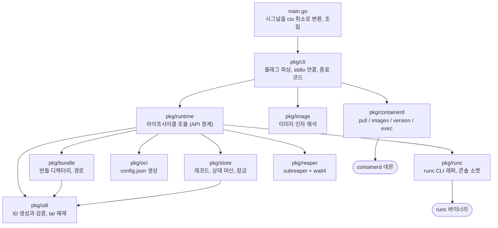
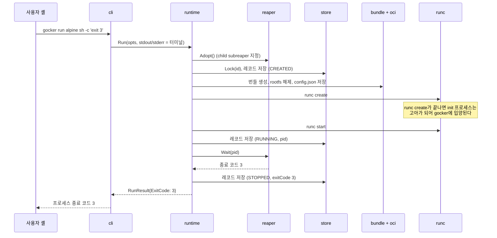

# Gocker Phase 2 아키텍처

- 기준: `phase2_clean` 브랜치, 커밋 `e8bf747` (2026-11-17)
- 범위: OCI 번들을 직접 만들고 runc CLI로 컨테이너를 제어하는 Phase 2 구조
- 관련 문서: [상태 모델과 라이프사이클](lifecycle.md), [설계 결정 기록](decisions.md), [운영 정책](policies.md), [테스트 보고서](phase2-test-report.md)

## 1. 한눈에 보기

Gocker는 **데몬이 없는 CLI**다. 명령 한 번이 프로세스 한 번이고, 명령이 끝나면 gocker 프로세스도 사라진다. 그래서 다음 세 가지가 구조 전체를 결정한다.

- 컨테이너에 대한 모든 사실은 디스크(`/var/lib/gocker`)와 runc가 가지고 있다. gocker는 메모리에 아무것도 유지하지 않는다.
- 서로 다른 gocker 프로세스가 같은 컨테이너를 동시에 건드릴 수 있으므로, 파일 잠금으로 직렬화한다.
- 컨테이너보다 gocker가 먼저 끝나는 경우(`run -d`)에는 그 뒤의 일(종료 코드 수거, 자동 삭제)을 해 줄 주체가 없다.

## 2. 구성 요소



### 패키지별 책임

| 패키지 | 책임 | 하지 않는 것 |
|---|---|---|
| `main` | SIGINT/SIGTERM을 ctx 취소로 바꾸고, 런타임과 CLI를 조립한다 | 명령 처리 |
| `pkg/cli` | 플래그 파싱, 표준 입출력을 어디에 연결할지 결정, 터미널 raw 모드 전환과 복구, 컨테이너 종료 코드를 프로세스 종료 코드로 반환 | 컨테이너 상태 판단 |
| `pkg/runtime` | 생성, 시작, 실행, 중지, 삭제, 조회의 순서와 실패 처리. CLI가 보는 유일한 인터페이스(`ContainerRuntime`) | 터미널 제어, 플래그 해석 |
| `pkg/store` | 메타데이터 레코드 저장(원자적 쓰기), 상태 머신 규칙, 컨테이너 잠금과 이름 잠금 | runc 조회 |
| `pkg/bundle` | 번들 디렉터리 생성과 삭제, 모든 파일 경로 계산(`Layout`), rootfs 아카이브 해제 호출 | config.json 내용 |
| `pkg/oci` | OCI 런타임 명세(`config.json`) 생성과 저장 | 번들 경로 |
| `pkg/runc` | `runc create/start/kill/state/delete` 실행, 실패 원인 분류, PTY master 수신(콘솔 소켓) | 상태 저장 |
| `pkg/reaper` | child subreaper 지정, 특정 PID의 종료 상태 수거 | 컨테이너 식별 |
| `pkg/image` | `alpine`, 아카이브 경로 같은 이미지 인자를 rootfs 아카이브 경로와 명령으로 분리 | 이미지 다운로드 |
| `pkg/util` | 컨테이너 ID 생성과 형식 검증, tar/tar.gz 해제 | |
| `pkg/containerd` | Phase 1에서 만든 containerd 클라이언트 | runc 기반 컨테이너 |

### `pkg/runtime` 내부 파일

| 파일 | 내용 |
|---|---|
| [runtime.go](../pkg/runtime/runtime.go) | 인터페이스, `Create`, `start`, `remove`, `get`, `observe`, `List` |
| [run.go](../pkg/runtime/run.go) | `Run`, 터미널 실행, 종료 대기, 취소 시 종료 절차, 종료 코드 기록 |
| [stop.go](../pkg/runtime/stop.go) | `stop`과 종료 확인 보조 함수 |
| [resolve.go](../pkg/runtime/resolve.go) | 공개 메서드(`Start`, `Stop`, `Delete`, `Get`)와 컨테이너 참조 해석 |
| [rollback.go](../pkg/runtime/rollback.go) | 역순 롤백 추적기 |
| [state.go](../pkg/runtime/state.go) | `store`의 메타데이터와 상태 타입을 별칭으로 노출 |

## 3. 의존 규칙

- **CLI는 `runtime`만 안다.** `store`의 타입은 `runtime`이 별칭으로 내보내므로 CLI가 `store`를 직접 import하지 않는다.
- **`runtime`은 하위 패키지를 인터페이스로 주입받는다.** `NewContainerRuntime(bundle, oci, runc, store, reaper)`에 `nil`을 넘기면 기본 구현을 쓴다. 단위 테스트는 여기에 가짜 runc와 가짜 reaper를 넣는다.
- **하위 패키지끼리는 서로를 모른다.** `store`, `bundle`, `oci`, `runc`, `reaper`는 `util` 외에 서로를 import하지 않는다. 이들을 엮는 것은 `runtime`뿐이다.
- **외부 프로세스 호출은 두 곳에만 있다.** runc 바이너리는 `pkg/runc`, containerd 데몬은 `pkg/containerd`를 통해서만 접근한다.

## 4. 명령과 백엔드

| 명령 | 백엔드 | 비고 |
|---|---|---|
| `create`, `start`, `run`, `stop`, `ps`, `rm` | runc | Phase 2에서 새로 구현. containerd가 꺼져 있어도 동작한다 |
| `pull`, `images`, `version` | containerd | 처음부터 계속 containerd를 쓰기로 한 명령 |
| `exec` | containerd | containerd 컨테이너만 대상. `gocker run`으로 만든 컨테이너에는 쓸 수 없다. 이후 `runc exec`로 확장 예정 |

containerd 클라이언트는 `pull`, `images`, `version`, `exec`를 호출할 때만 연결한다. 그래서 runc 기반 명령은 containerd 유무와 무관하다.

## 5. 디스크 레이아웃

```
/var/lib/gocker/
├── state/                     ← pkg/store 소유
│   ├── <id>.json              컨테이너 레코드 (이것이 있으면 컨테이너가 존재한다)
│   ├── <id>.lock              컨테이너 잠금 파일 (레코드가 없어지면 함께 지운다)
│   └── names.lock             이름 유일성 검사용 잠금 (잡고 있는 동안만 존재)
└── containers/<id>/           ← pkg/bundle 소유 (OCI 번들)
    ├── config.json            OCI 런타임 명세
    ├── rootfs/                아카이브를 푼 루트 파일 시스템
    ├── container.pid          runc create가 기록한 init 프로세스의 호스트 PID
    ├── container.log          출력 대상을 지정하지 않았을 때의 stdout/stderr
    └── runc.log               runc 자체의 진단 로그

/run/runc/<id>/                ← runc 소유 (tmpfs, 재부팅하면 비워진다)
$TMPDIR/gocker-console-<pid>.sock   ← -t일 때 runc create 동안만 존재
```

컨테이너 ID는 12자리 소문자 16진수다. 레코드와 번들은 서로 다른 디렉터리에 있고 소유 패키지도 다르다.

## 6. 대표 흐름: 포그라운드 `run`

`gocker run alpine sh -c 'exit 3'`을 실행했을 때의 순서다.



실행 방식에 따라 달라지는 부분은 다음과 같다.

| 실행 방식 | 달라지는 점 |
|---|---|
| `run --rm` | 반환 직전에 컨테이너를 강제 삭제한다 (runc → 번들 → 레코드) |
| `run -t` | 콘솔 소켓으로 PTY master를 받아 컨테이너가 끝날 때까지 쥐고 있는다. 입력과 출력을 복사하는 고루틴이 master와 터미널을 잇는다 |
| `run -d` | `Adopt`와 `Wait`를 하지 않는다. 시작 후 ID를 출력하고 바로 반환한다. 종료 코드는 얻지 못한다 |
| `create` + `start` | 위 흐름의 앞부분과 뒷부분을 서로 다른 gocker 프로세스가 나눠서 한다 |

## 7. 표준 입출력 연결

| 실행 방식 | 컨테이너 stdin | 컨테이너 stdout / stderr |
|---|---|---|
| `run` (포그라운드) | `/dev/null` | gocker의 stdout/stderr 파일을 그대로 물려준다 |
| `run -i` (포그라운드) | gocker의 stdin 파일을 그대로 물려준다 | 위와 같음 |
| `run -t`, `run -it` | PTY (gocker가 stdin을 master로 복사) | PTY (gocker가 master를 stdout으로 복사) |
| `run -d`, `create` | `/dev/null` | `container.log` |

TTY가 아닌 경로에서는 복사 고루틴을 두지 않고 파일 디스크립터를 직접 물려준다. gocker가 끝나도 컨테이너의 출력이 끊기지 않고, 입력의 끝(EOF)이 자연스럽게 전달된다.

## 8. 테스트 구조

| 종류 | 위치 | 실행 환경 | 규모 (`e8bf747`) |
|---|---|---|---|
| 단위 테스트 | 각 패키지의 `*_test.go` | root 불필요. `runtime`은 가짜 runc와 가짜 reaper로 검증 | 88개 통과 |
| E2E | [scripts/e2e.sh](../scripts/e2e.sh) | root, 실제 runc | 41개 케이스 |
| 전체 명령과 플래그 | [scripts/fulltest.sh](../scripts/fulltest.sh) | root, 실제 runc와 containerd. 호스트의 gocker 컨테이너를 모두 지우고 containerd를 잠시 멈춘다 | 192개 테스트 ([결과](phase2-test-report.md)) |
| CI | `.github/workflows/e2e.yml` | GitHub Actions, runc 버전 고정 | E2E 실행 |

## 9. Phase 3와의 경계

Phase 3는 namespace, cgroup, rootfs, 네트워크를 직접 조합한다. 지금 구조에서 그 작업이 닿는 곳은 `runtime`이 `runc.RuncClient` 인터페이스로 호출하는 부분이다. 레코드, 상태 머신, 잠금, 롤백, 종료 코드 수거는 runc에 묶여 있지 않으므로 그대로 쓸 수 있을 것으로 본다. 이것은 구조에서 읽히는 예상이고 아직 검증하지 않았다.
