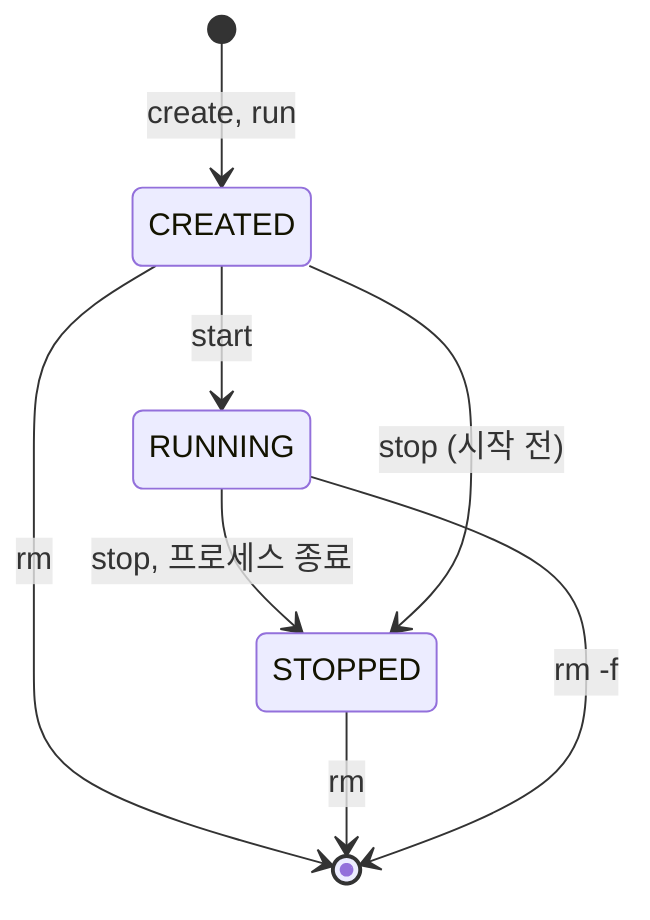

# Gocker Phase 2 상태 모델과 라이프사이클

- 기준: `phase2_clean` 브랜치, 커밋 `e8bf747` (2026-11-17)
- 관련 문서: [아키텍처](architecture.md), [설계 결정 기록](decisions.md), [운영 정책](policies.md)

## 1. 상태

| 상태 | 뜻 | 저장 여부 |
|---|---|---|
| `CREATED` | 번들과 runc 컨테이너가 만들어졌고 사용자 명령은 아직 실행되지 않았다 | 저장 |
| `RUNNING` | 컨테이너 프로세스가 실행 중이다 | 저장 |
| `STOPPED` | 컨테이너 프로세스가 끝났다. 번들과 레코드는 남아 있다 | 저장 |
| `DELETED` | 삭제되었다 | 저장하지 않음. 레코드가 없는 것으로 표현한다 |



- `STOPPED`에서 나가는 전이는 삭제뿐이다. **중지된 컨테이너는 다시 시작할 수 없다.**
- 같은 상태로의 전환은 허용한다. `stop`을 두 번 호출해도 성공한다.
- 규칙은 [store/state.go](../pkg/store/state.go)의 `allowedTransitions`에 있다.

## 2. 저장된 상태와 관측한 상태

컨테이너의 상태를 말해 주는 곳이 둘이다.

| | 저장된 상태 | 관측한 상태 |
|---|---|---|
| 출처 | `/var/lib/gocker/state/<id>.json` | `runc state <id>` |
| 뜻 | gocker 명령이 마지막으로 기록한 것 | 지금 실제로 프로세스가 어떤지 |
| 바꾸는 방법 | `TransitionTo` (상태 머신 규칙을 검사) | `ApplyObserved` (규칙을 검사하지 않음) |

둘이 어긋나는 이유는 데몬이 없기 때문이다. 컨테이너가 스스로 끝나도 그 순간 레코드를 고쳐 줄 프로세스가 없다.

**실행 중인지에 대해서는 runc가 기준이다.** 조회할 때마다 저장된 레코드를 읽고 그 위에 runc 관측을 덮어 보여 준다.

| runc가 말하는 것 | 저장된 상태 | 사용자에게 보이는 상태 |
|---|---|---|
| `running` | 무엇이든 | `RUNNING` (PID는 runc가 알려 준 값) |
| `stopped` | 무엇이든 | `STOPPED` |
| `created`, `creating` | 무엇이든 | 저장된 상태 그대로 |
| 그런 컨테이너 없음 | `RUNNING` | `STOPPED` (유령 RUNNING, 4장 참고) |
| 그런 컨테이너 없음 | `CREATED`, `STOPPED` | 저장된 상태 그대로 |
| 조회 실패 (그 밖의 이유) | 무엇이든 | 저장된 상태 그대로 |

**조회는 레코드를 고치지 않는다.** `ps`와 내부 조회(`get`)는 관측 결과를 반환값에만 반영한다. 레코드를 쓰는 것은 상태를 바꾸는 명령뿐이다.

## 3. 누가 레코드를 쓰는가

| 시점 | 레코드에 쓰는 내용 |
|---|---|
| `create`, `run`의 시작 | 새 레코드 (`CREATED`). 번들과 runc 컨테이너보다 먼저 쓴다 |
| `start` 성공 | `RUNNING`, PID |
| `stop`이 종료를 확인 | `STOPPED` |
| 포그라운드 `run`이 종료 상태를 수거 | `STOPPED`, `exitCode` |
| `rm` | 레코드 삭제 (가장 마지막에) |
| `ps` | 쓰지 않음 |

이 표에서 따라 나오는 동작이 있다.

- `run -d`로 띄운 컨테이너가 스스로 끝나면 **레코드는 `RUNNING`인 채로 남는다.** `ps -a`는 runc 관측에 따라 `STOPPED`로 보여 준다.
- 그 컨테이너에 `stop`을 호출하면 신호를 보내지 않고 레코드만 `STOPPED`로 맞춘다.
- `rm`은 관측한 상태로 판단하므로, 레코드가 `RUNNING`이어도 실제로 끝났으면 `-f` 없이 지울 수 있다.

## 4. 유령 RUNNING

재부팅하면 runc의 상태 디렉터리(`/run/runc`, tmpfs)가 비워진다. 프로세스는 이미 없는데 레코드만 `RUNNING`으로 남는다.

- 레코드가 `RUNNING`이고 runc가 그 컨테이너를 모르면 `STOPPED`로 보여 준다.
- 레코드는 고치지 않는다. `stop`이나 `rm`을 호출하면 그때 정리된다.
- `CREATED`에는 적용하지 않는다. 생성 도중에는 레코드가 runc 컨테이너보다 먼저 만들어지므로 "runc가 모른다"가 정상이기 때문이다.

구현은 [runtime.go](../pkg/runtime/runtime.go)의 `observe`에 있다.

## 5. 명령별 동작

"상태"는 관측을 반영한 상태다.

| 명령 | `CREATED` | `RUNNING` | `STOPPED` |
|---|---|---|---|
| `start` | 시작한다 | 실패 (이미 실행 중) | 실패 (다시 시작할 수 없음) |
| `stop` | 중지하고 `STOPPED` 기록 | SIGTERM, 필요하면 SIGKILL 후 `STOPPED` 기록 | 성공 (신호를 보내지 않음) |
| `rm` | 삭제한다 | 실패. `-f`를 주면 강제 삭제 | 삭제한다 |
| `ps` | `-a`일 때 표시 | 표시 | `-a`일 때 표시 |

`stop`은 저장된 상태가 아니라 runc 관측만 보고 판단한다. 레코드는 `STOPPED`인데 실제로는 살아 있는 컨테이너도 중지된다.

## 6. 만드는 순서와 지우는 순서

| | 순서 | 이유 |
|---|---|---|
| 생성 | 레코드 → 번들 → runc 컨테이너 | 도중에 gocker가 죽어도 컨테이너가 `ps -a`에 보이고 `rm`으로 지울 수 있다 |
| 생성 실패 시 롤백 | runc 컨테이너 → 번들 → 레코드 | 생성의 역순 |
| 삭제 | runc 컨테이너 → 번들 → 레코드 | 도중에 실패해도 레코드가 남아 다시 `rm`할 수 있다 |

원칙은 하나다. **컨테이너가 존재한다는 것은 레코드가 있다는 것이다.** 번들과 runc 컨테이너는 레코드에 딸린 리소스다. 레코드는 항상 가장 먼저 생기고 가장 나중에 사라진다.

롤백과 삭제는 도중에 실패하면 거기서 멈춘다. 자세한 규칙은 [운영 정책](policies.md)에 있다.

## 7. 종료 코드

종료 상태는 커널이 부모 프로세스에게만 넘겨준다. `runc create`는 컨테이너 프로세스를 만든 뒤 곧바로 끝나므로, 컨테이너 프로세스는 고아가 되어 호스트의 PID 1에 입양되고 종료 코드는 거기서 버려진다.

포그라운드 `run`은 `runc create` 전에 gocker를 child subreaper로 지정한다. 그러면 고아가 된 컨테이너 프로세스가 gocker에 입양되고, gocker가 직접 `wait4`로 종료 상태를 수거한다.

| 실행 방식 | 종료 코드 | 레코드의 `exitCode` |
|---|---|---|
| 포그라운드 `run`, 정상 종료 | 컨테이너의 종료 코드 | 기록 |
| 포그라운드 `run`, 시그널로 종료 | 128 + 시그널 번호 (SIGKILL이면 137) | 기록 |
| 포그라운드 `run`을 다른 터미널에서 `stop` | 위 두 규칙과 같다 | 기록 |
| `run -d`, `create` + `start` | 얻지 못한다 (`run -d` 자체는 0으로 끝난다) | 없음 |

`run -d`에서 종료 코드가 없는 것은 데몬이 없는 구조에서 받아들인 한계다.

## 8. 컨테이너 레코드

```json
{
  "id": "3f9a1c0b7e2d",
  "name": "web",
  "createdAt": "2026-11-17T01:23:45.678Z",
  "image": "assets/alpine-minirootfs.tar.gz",
  "command": ["sh", "-c", "exit 3"],
  "bundlePath": "/var/lib/gocker/containers/3f9a1c0b7e2d",
  "state": "STOPPED",
  "pid": 0,
  "exitCode": 3
}
```

- `name`과 `exitCode`는 값이 없으면 필드 자체가 없다.
- `pid`는 `RUNNING`일 때만 0이 아니다.
- 레코드는 임시 파일에 쓰고 fsync한 뒤 rename한다. 쓰는 도중 중단돼도 기존 레코드가 깨지지 않는다.

## 9. 컨테이너 참조

`start`, `stop`, `rm`은 ID 대신 이름이나 ID의 앞부분을 받을 수 있다.

| 순서 | 일치 조건 |
|---|---|
| 1 | 전체 ID (12자리) |
| 2 | 이름이 정확히 같거나, ID가 그 문자열로 시작 (4자 이상일 때만) |

- 2번에서 후보가 둘 이상이면 고르지 않고 에러를 반환한다.
- 이름은 컨테이너 사이에서 유일하다. 삭제하면 그 이름을 다시 쓸 수 있다.
- 해석은 저장된 레코드만 보고 한다. runc를 조회하지 않는다.

## 10. 시나리오로 보는 상태 변화

**포그라운드 실행**

| 순간 | 레코드 | runc | 보이는 상태 |
|---|---|---|---|
| `run` 시작 | `CREATED` | 없음 → `created` | `CREATED` |
| `runc start` 뒤 | `RUNNING` | `running` | `RUNNING` |
| 프로세스 종료, gocker가 수거 | `STOPPED`, `exitCode` | `stopped` | `STOPPED` |

**백그라운드 실행 후 스스로 종료**

| 순간 | 레코드 | runc | 보이는 상태 |
|---|---|---|---|
| `run -d` 반환 | `RUNNING` | `running` | `RUNNING` |
| 프로세스 종료 (gocker 없음) | `RUNNING` | `stopped` | `STOPPED` |
| `stop` 호출 | `STOPPED` | `stopped` | `STOPPED` |

**실행 중 재부팅**

| 순간 | 레코드 | runc | 보이는 상태 |
|---|---|---|---|
| 재부팅 전 | `RUNNING` | `running` | `RUNNING` |
| 재부팅 후 | `RUNNING` | 없음 | `STOPPED` |
| `rm` 호출 | 삭제 | 없음 | 없음 |
